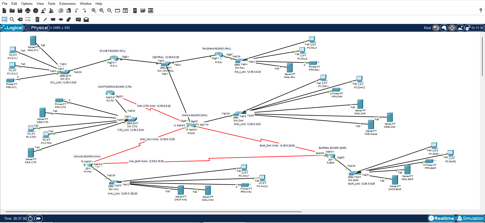
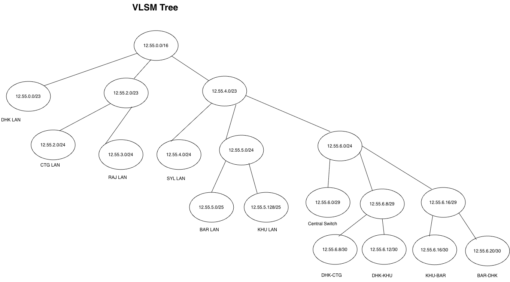
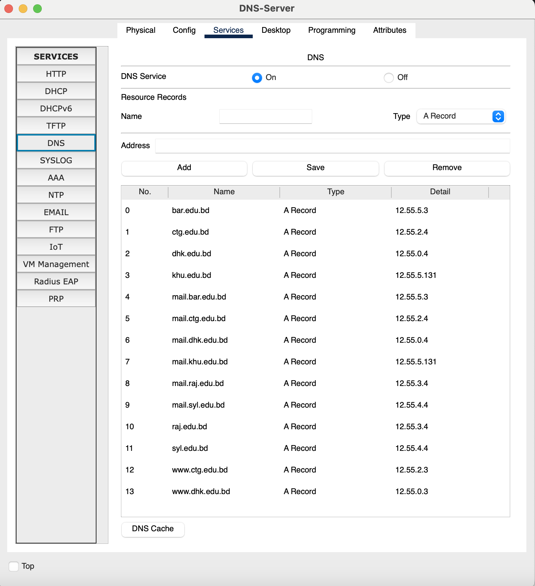
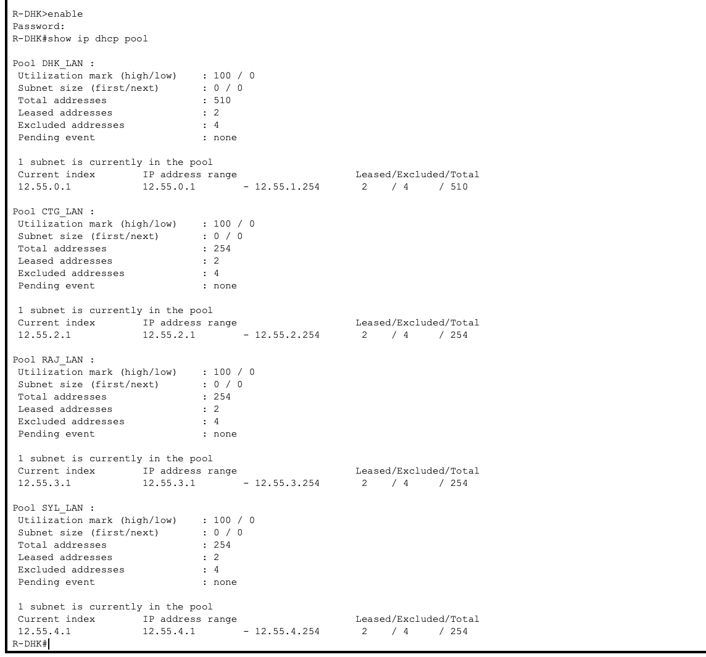
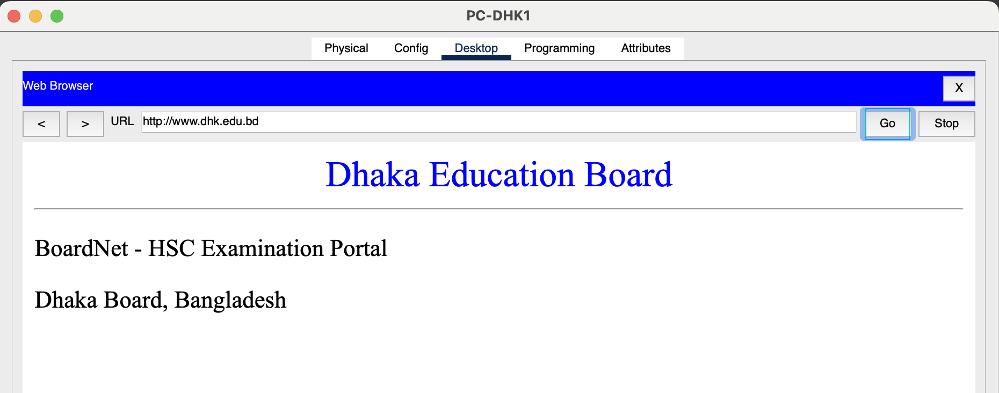
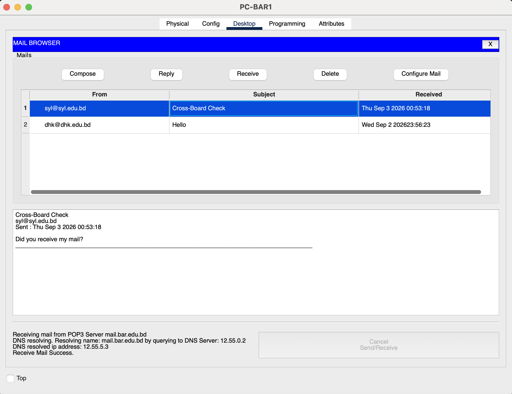

# CSE421 Project – BoardNet: Board Examination Communication Network

A multi-site enterprise network for six HSC education boards of Bangladesh, built in **Cisco Packet Tracer**. It combines VLSM addressing, RIPv2, static and floating static routing with automatic failover, centralised and local DHCP, a central DNS server, two web servers and six inter-connected email servers.

**Course:** CSE421 – Computer Networks, BRAC University (Summer 2026)
**Team:** Omar Faruk, Mehjabin Mostare Momo



## Scenario

The Ministry of Education wants a unified network named BoardNet for HSC exam coordination. Six boards are connected, and each has its own LAN sized for the hosts it needs:

| Board | Abbreviation | Required hosts |
|---|---|---|
| Dhaka | DHK | 300 |
| Chattogram | CTG | 200 |
| Rajshahi | RAJ | 160 |
| Sylhet | SYL | 150 |
| Barishal | BAR | 120 |
| Khulna | KHU | 120 |

**Topology rules from the brief:**
- **DHK, SYL and RAJ** share a central coordination switch.
- **DHK, KHU and BAR** form a triangle of point-to-point serial links.
- **CTG** is isolated and connects only to DHK.
- Each board has a LAN switch, one email server, one printer and two PCs. DHK also hosts the central DNS server and a web server, and CTG has a web server.

## IP addressing (VLSM)

The base network comes from the last four digits of the first member's student ID (…**1255**), which gives **12.55.0.0/16**.



| Network | Hosts needed | Block | Network address | Usable range | Broadcast | Subnet mask |
|---|---|---|---|---|---|---|
| DHK LAN | 300 | 512 | 12.55.0.0/23 | 12.55.0.1 – 12.55.1.254 | 12.55.1.255 | 255.255.254.0 |
| CTG LAN | 200 | 256 | 12.55.2.0/24 | 12.55.2.1 – 12.55.2.254 | 12.55.2.255 | 255.255.255.0 |
| RAJ LAN | 160 | 256 | 12.55.3.0/24 | 12.55.3.1 – 12.55.3.254 | 12.55.3.255 | 255.255.255.0 |
| SYL LAN | 150 | 256 | 12.55.4.0/24 | 12.55.4.1 – 12.55.4.254 | 12.55.4.255 | 255.255.255.0 |
| BAR LAN | 120 | 128 | 12.55.5.0/25 | 12.55.5.1 – 12.55.5.126 | 12.55.5.127 | 255.255.255.128 |
| KHU LAN | 120 | 128 | 12.55.5.128/25 | 12.55.5.129 – 12.55.5.254 | 12.55.5.255 | 255.255.255.128 |
| Central switch (DHK–SYL–RAJ) | 3 | 8 | 12.55.6.0/29 | 12.55.6.1 – 12.55.6.6 | 12.55.6.7 | 255.255.255.248 |
| DHK–CTG | 2 | 4 | 12.55.6.8/30 | 12.55.6.9 – 12.55.6.10 | 12.55.6.11 | 255.255.255.252 |
| DHK–KHU | 2 | 4 | 12.55.6.12/30 | 12.55.6.13 – 12.55.6.14 | 12.55.6.15 | 255.255.255.252 |
| KHU–BAR | 2 | 4 | 12.55.6.16/30 | 12.55.6.17 – 12.55.6.18 | 12.55.6.19 | 255.255.255.252 |
| BAR–DHK | 2 | 4 | 12.55.6.20/30 | 12.55.6.21 – 12.55.6.22 | 12.55.6.23 | 255.255.255.252 |

### Router interfaces

| Router | Interface | IP address | Connects to |
|---|---|---|---|
| R-DHK | G0/0 | 12.55.0.1/23 | DHK LAN |
| | G0/1 | 12.55.6.1/29 | Central switch |
| | S0/0/0 (DCE) | 12.55.6.9/30 | R-CTG |
| | S0/0/1 (DCE) | 12.55.6.13/30 | R-KHU |
| | S0/1/0 (DCE) | 12.55.6.22/30 | R-BAR |
| R-CTG | G0/0 | 12.55.2.1/24 | CTG LAN |
| | S0/0/0 | 12.55.6.10/30 | R-DHK |
| R-SYL | G0/0 | 12.55.4.1/24 | SYL LAN |
| | G0/1 | 12.55.6.2/29 | Central switch |
| R-RAJ | G0/0 | 12.55.3.1/24 | RAJ LAN |
| | G0/1 | 12.55.6.3/29 | Central switch |
| R-KHU | G0/0 | 12.55.5.129/25 | KHU LAN |
| | S0/0/0 | 12.55.6.14/30 | R-DHK |
| | S0/0/1 (DCE) | 12.55.6.17/30 | R-BAR |
| R-BAR | G0/0 | 12.55.5.1/25 | BAR LAN |
| | S0/0/0 | 12.55.6.18/30 | R-KHU |
| | S0/0/1 | 12.55.6.21/30 | R-DHK |

### Servers (static IPs)

| Server | IP address | Board |
|---|---|---|
| DNS-Server | 12.55.0.2 | DHK |
| WEB-DHK (`www.dhk.edu.bd`) | 12.55.0.3 | DHK |
| WEB-CTG (`www.ctg.edu.bd`) | 12.55.2.3 | CTG |
| MAIL-DHK / CTG / RAJ / SYL | 12.55.0.4 / 12.55.2.4 / 12.55.3.4 / 12.55.4.4 | each board |
| MAIL-BAR / MAIL-KHU | 12.55.5.3 / 12.55.5.131 | each board |
| DHCP-BAR / DHCP-KHU | 12.55.5.2 / 12.55.5.130 | BAR / KHU |

Printers use the `.5` address of their LAN (`.4` on BAR, `.132` on KHU). All PCs get their addresses from DHCP.

## Routing design

| Router | Routing | Details |
|---|---|---|
| R-DHK | RIPv2 + static | Runs RIPv2 toward SYL and RAJ and advertises itself as their default gateway (`default-information originate`). Has static routes to the CTG, KHU, BAR and KHU–BAR networks, plus floating backups (AD 5). |
| R-SYL, R-RAJ | RIPv2 | Learn DHK's networks and a default route from DHK through RIP. The LAN interface is passive. |
| R-CTG | Default route | `0.0.0.0/0` points to DHK, the only way out. |
| R-KHU, R-BAR | Static + floating static | A primary route to every network via DHK (AD 1), plus a **floating backup via the other router (AD 5)**. |

**Redundancy:** if the DHK–KHU link goes down, KHU's primary routes are withdrawn and the AD-5 routes send its traffic through BAR. In the same way, BAR fails over through KHU if the DHK–BAR link goes down. DHK has matching floating routes, so return traffic also takes the backup path.

The full IOS configuration of every router is in [`configs/`](configs).

## Services

| Service | Where | How |
|---|---|---|
| **DHCP (central)** | R-DHK | Four pools (DHK, CTG, RAJ, SYL), with `.1–.10` of each LAN excluded for static devices. CTG, SYL and RAJ forward requests to DHK with `ip helper-address`. |
| **DHCP (local)** | DHCP-KHU, DHCP-BAR servers | Each serves its own LAN, with the gateway set to the local router and DNS set to 12.55.0.2. |
| **DNS** | DNS-Server (DHK) | A records for `www.dhk.edu.bd`, `www.ctg.edu.bd`, `mail.<board>.edu.bd` and the bare `<board>.edu.bd` domains. The bare domains are needed for SMTP delivery between boards. |
| **Web** | WEB-DHK, WEB-CTG | HTTP pages for each board, reachable by domain name from every board. |
| **Email** | MAIL-xxx on every board | SMTP + POP3, one domain per board (`dhk.edu.bd`, `ctg.edu.bd`, …), with each PC's mail client set up for its board. |

<table>
<tr>
<td><br><sub>DNS A records on the central server</sub></td>
<td><br><sub><code>show ip dhcp pool</code> on R-DHK</sub></td>
</tr>
<tr>
<td><br><sub>www.dhk.edu.bd opened from PC-DHK1</sub></td>
<td><br><sub>Mail from SYL received on PC-BAR1</sub></td>
</tr>
</table>

## Verification

- Every device on all six boards can ping every other device.
- All PCs get addresses from the correct DHCP server (DHK router or the local KHU/BAR server).
- Both websites open by domain name from every board.
- DNS resolution works from every board network.
- Email can be sent and received between boards.
- Failover works: with DHK–KHU shut down, KHU still reaches every network through BAR. With DHK–BAR shut down, BAR still reaches every network through KHU.

## Work distribution

| Member | Responsibilities |
|---|---|
| **Omar Faruk** | All servers, end devices and services: DNS, 2 web servers, 6 email servers, PC mail settings, service testing and verification. Built and configured the **CTG, SYL and RAJ** boards: routers, switches, LANs, DHCP relay, RIP and default routing. |
| Mehjabin Mostare Momo | Core topology and the **DHK, KHU and BAR** boards: R-DHK, central switch, DHCP pools, RIP, static and floating routes, serial links, local DHCP servers and redundancy testing. |

## Repository structure

```
├── BoardNet.pkt              # Complete Packet Tracer topology with all configurations
├── configs/                  # IOS configuration of all six routers
├── images/                   # Topology, VLSM tree and verification screenshots
├── Project_Instruction.pdf   # Assignment brief
├── Project_Report.pdf        # Full report (addressing tables, configs, DNS/DHCP/web/mail setup)
└── Work_Distribution.pdf
```

## How to open

1. Install [Cisco Packet Tracer](https://www.netacad.com/cisco-packet-tracer) (free with a Cisco Networking Academy account).
2. Open `BoardNet.pkt`.
3. Try it out: ping between boards from any PC's *Command Prompt*, open `www.ctg.edu.bd` in a PC's *Web Browser*, or send mail from the *Email* app. To test failover, shut down `Serial0/0/1` on R-DHK and ping from the KHU LAN again.

Router passwords are the lab defaults: console/VTY `cisco`, enable secret `class`.

## Assumptions

- Cisco 2911 routers with HWIC-2T serial modules. DHK needs five interfaces, so it has two modules.
- Clock rate 64000 on every DCE serial end.
- The two PCs per board stand for all hosts. Subnets are still sized for the full host counts.
- KHU and BAR use explicit static routes instead of a default route, because the brief says they must know every network.
- Fa0/24 on each LAN switch is reserved for the router uplink.
